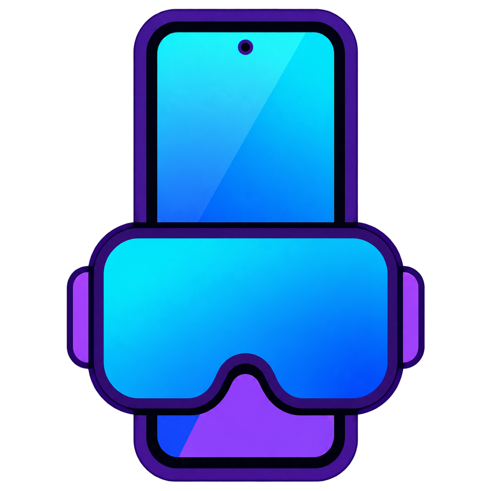
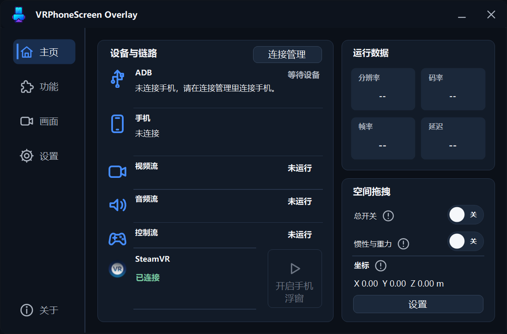
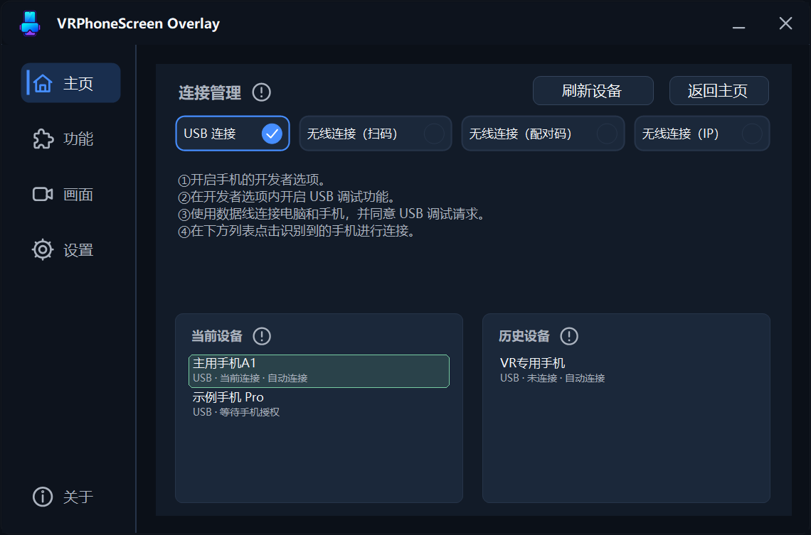
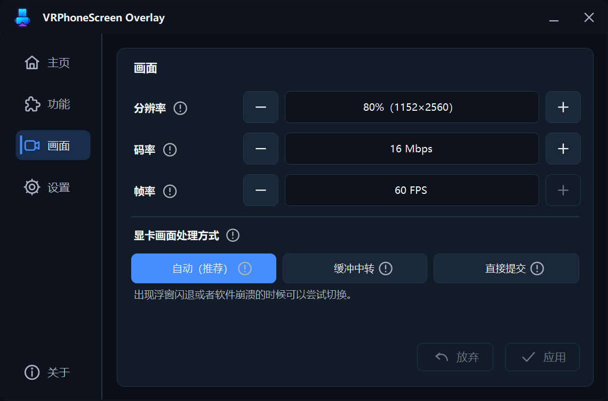

# VRPhoneScreen Overlay

**在 VR 里操作手机、翻译画面、分享截图。**

Windows x64 · SteamVR · Android · USB / 无线连接

当前正式版本 **0.3.0** · 解压即用

**[官网下载](https://hoshinochika.com/vrpso/download/) · [GitHub 下载](https://github.com/HoshinoChika/VRPhoneScreenOverlay/releases/latest) · [使用教程](https://hoshinochika.com/vrpso/guide/)**

## 能做什么

| 功能 | 说明 |
| :--- | :--- |
| 操作手机 | 用手柄点击、滑动、滚动，返回桌面或切换应用。 |
| 摆放浮窗 | 抓取、缩放、调整透明度，隐藏后长按手柄按键唤回。 |
| 手机声音 | 将支持采集的手机内部音频播放到电脑或头显。 |
| 有线和无线连接 | 支持 USB、二维码、配对码和手动 IP 连接。 |
| 截图识图 | 翻译 VR 画面、解答题目、理解图片内容。支持内置服务和个人 DeepSeek API Key。 |
| 截图发手机 | 选择截图范围，倒计时后将图片发送到手机。 |
| 手机剪贴板 | 在浮窗中查看复制内容，解析支持的视频链接。 |
| VRChat 相册同步 | 开启后，将新拍的照片同步到已连接手机。 |
| 画面设置 | 调整分辨率、码率、帧率和显卡画面处理模式。 |
| 手柄与辅助功能 | 查看或调整手柄绑定，按需开启空间拖拽和 PICO 麦克风改善功能。 |

<table>
<tr>
<td width="50%"> <b>连接管理</b> · 选择手机与连接方式</td>
<td width="50%"> <b>画面设置</b> · 调整画质</td>
</tr>
</table>

图片由 0.3.0 软件快照模式生成，点击可查看完整界面。

## 下载与更新

到[官网下载页](https://hoshinochika.com/vrpso/download/)或 [GitHub Release](https://github.com/HoshinoChika/VRPhoneScreenOverlay/releases/latest) 下载。

- 使用软件：下载 `VRPhoneScreenOverlay-0.3.0-win-x64.zip`，解压后运行 `VRPhoneScreenOverlay.exe`。
- 查看源码：下载 `VRPhoneScreenOverlay-0.3.0-source.zip`。
- 历史版本：在官网下载页选择对应版本。

**部分机器上旧版本更新可能会失败，需要重新下载完整包替换。**

## 开始使用

准备 Windows x64 电脑、SteamVR 和 Android 手机。PICO、Quest 等头显通过电脑进入 SteamVR 使用。无线调试配对通常需要 Android 11 或以上，内部音频采集取决于手机系统和应用支持。

1. 手机开启开发者选项及 USB 调试。
2. 用数据线连接电脑，在手机上允许调试授权；也可在同一局域网中使用无线调试配对。
3. 启动 SteamVR 和软件，在“连接管理”中选择手机并连接。
4. 打开手机浮窗，按“功能”页的手柄说明操作。

部分手机需要额外开启“USB 调试（安全设置）”。浮窗显示在你自己的 SteamVR 画面中。

[查看 USB、无线连接和常用功能教程 →](https://hoshinochika.com/vrpso/guide/)

## 截图与照片

- **识图服务**：在“设置”的“翻译”区域选择服务。软件内置服务目前免费，个人服务使用自己的 DeepSeek API Key。
- **翻译与识图**：在浮窗中选择截图识图功能，查看翻译、答题或图片理解结果。
- **截图发手机**：连接手机后，在浮窗菜单中选择截图发送，按提示完成倒计时。
- **相册同步**：在“设置”中开启“VRChat相册同步”，保持软件运行和手机连接，新拍照片会自动发送到手机。

## 遇到问题

加入测试交流 QQ 群 **1075716261**，或到 [Issues](https://github.com/HoshinoChika/VRPhoneScreenOverlay/issues) 反馈。请提供软件版本、设备型号、问题现象和复现步骤。

软件会在本机保存运行和故障记录。需要协助时，在“关于 → 上传问题诊断包”填写现象并手动上传；附带内存资料时单独确认。

## 贡献者

| 贡献者 | 分工 |
| :--- | :--- |
| [HoshinoChika](https://github.com/HoshinoChika) | 提出项目想法和功能需求，负责实际使用中的测试与验收。 |
| Codex（GPT-6.1 Sol、GPT-6 Astra） | 根据需求完成实际开发，包括代码实现、问题修复和相关验证。 |

## 参考项目

本项目使用或参考了以下项目：

| 项目 / 作者 | 本项目的使用或参考 |
| :--- | :--- |
| [scrcpy](https://github.com/Genymobile/scrcpy) · Genymobile、Romain Vimont | 手机画面、音频和控制功能的基础。 |
| [OVR Advanced Settings](https://github.com/OpenVR-Advanced-Settings/OpenVR-AdvancedSettings) · Advanced Settings 团队 | 空间拖拽、惯性、重力及手柄绑定的参考。 |
| [PicoStreamingMicrophoneKeeper](https://github.com/Kill11/PicoStreamingMicrophoneKeeper) · Kill11 | PICO 麦克风延迟改善功能的参考。 |
| [OpenVR](https://github.com/ValveSoftware/openvr) · Valve | SteamVR 浮窗和手柄接口。 |

[第三方说明](THIRD_PARTY.md)

项目采用 [GPL-3.0](LICENSE)，第三方组件遵循各自许可证。
